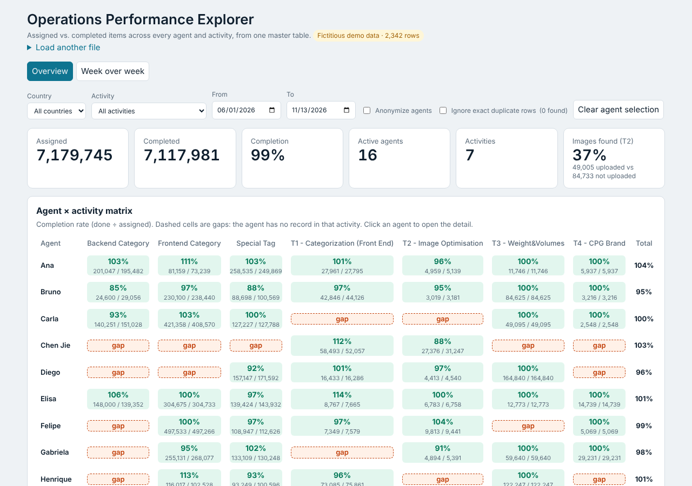
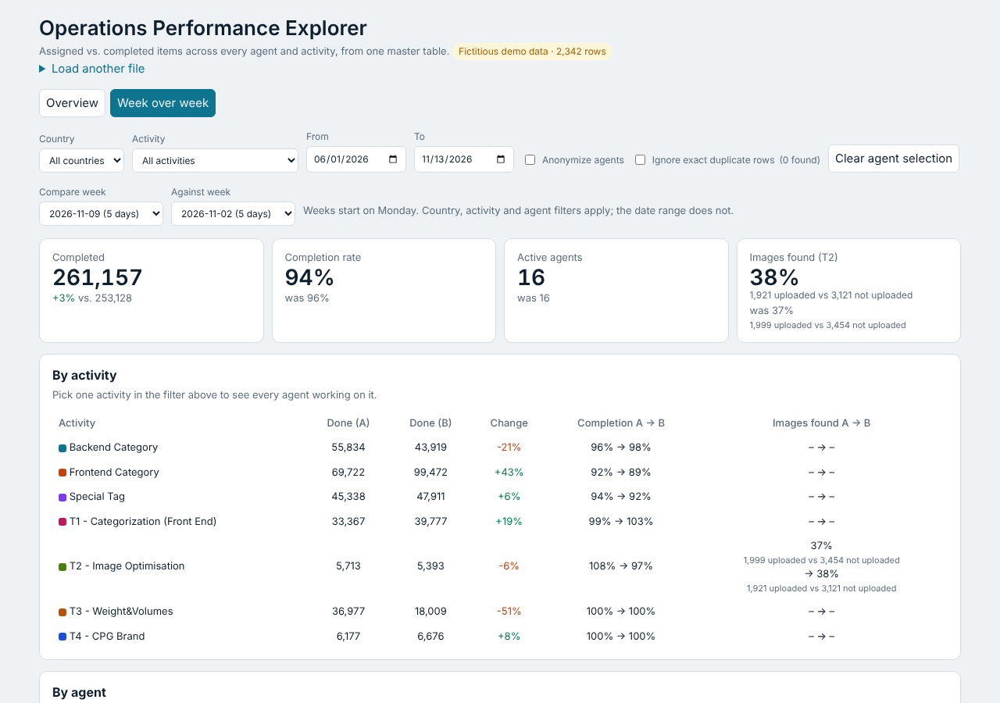

# Operations Performance Explorer

An automated pipeline and interactive dashboard for an operations team that prepares catalog data
(categorization, image optimization, weights and volumes, brands) for the launch of an online grocery app.

> **All data in this repository is fictitious.** Agent names, volumes and dates were generated for the demo.
> Spreadsheet IDs were replaced with placeholders.

**Live demo:** `https://<Kaue-Melo>.github.io/operations-performance-explorer/`



## The problem

Each activity was tracked in its own spreadsheet, kept by a different group of agents, with different
column names, date formats and number formats. Answering simple questions meant opening seven files:

- Who worked on what this week, and how much of the assigned work was completed?
- Which agents have never touched a given activity (gaps for rotation and cross-training)?
- How did this week compare with the last one, per activity and per agent?
- In image optimization, what share of products had a usable image found?

## What was built

```
7 source spreadsheets ──► ingest_sources.gs ──► task tabs (main_control) ──► consolidate_main_data.gs ──► Main Data
                         (daily trigger, 6:00)                                                          │
                                                                                                       ▼
                                                                         webapp.gs + Explorer.html (Apps Script Web App)
```

1. **Ingestion (`apps-script/ingest_sources.gs`)**: reads every source sheet, normalizes it and appends the
   missing days to the master spreadsheet.
2. **Consolidation (`apps-script/consolidate_main_data.gs`)**: merges every task tab into one long table,
   *Main Data* (country, user, date, task, assigned, done, uploaded, not uploaded).
3. **Dashboard (`apps-script/webapp.gs` + `Explorer.html`)**: served as a Google Apps Script Web App that reads
   Main Data when the page opens. Every morning, people open one link and see the previous day. Nothing has to
   be exported or uploaded, and the page is restricted to the company domain.

A time-driven trigger runs ingestion and consolidation every day between 6:00 and 7:00 (São Paulo), on Google's
servers. A failed source does not block the others, and Apps Script e-mails the owner when a run fails.

## Dashboard features

- **Agent × activity matrix**: completion rate (done ÷ assigned) per cell, with gaps highlighted.
- **Rotation timeline**: which activities each agent worked on, week by week.
- **Week over week**: any two weeks, by activity and by agent, with completion-rate changes.
- **Images found (T2)**: uploaded ÷ (uploaded + not uploaded), always shown with the raw counts.
- Filters for country, activity and date range, plus an **anonymize agents** switch for external audiences
  and an option to ignore exact duplicate rows.
- Loads any CSV export or pasted cells. The data stays in the browser.



## Engineering decisions worth noting

- **Idempotent ingestion.** The key is the agent (accent-insensitive) plus the date. Duplicate source rows are
  summed, and re-running the script after a timeout never duplicates data.
- **Manual edits are protected.** Rows older than 3 days are never overwritten. Rows from the last 3 days are
  refreshed from the source, to pick up numbers that agents fill in late. Every difference is logged.
- **Today is skipped** because it may be incomplete. It is picked up by the next run.
- **Dry run first.** `previewIngest()` writes what would change to an *Ingestion Log* tab and writes no data.
- **Messy dates handled explicitly.** The script reads `20th September` with no year, `28,08`, `dd/mm/yyyy`,
  and sheets set to the en_US locale where a typed `03/11` silently becomes March 11 (these are read as
  displayed). Dates outside a 45-day window are flagged as likely day/month swaps instead of being inserted.
- **Locale-aware numbers.** It handles both `7,797` (thousands comma) and `58.549` (thousands dot).
- **Robust CSV parsing** in the page: quoted fields such as `"100,0%"` no longer shift the columns.

## Repository layout

| Path | What it is |
|---|---|
| `index.html` | Standalone demo with fictitious data embedded. Opens directly in a browser or on GitHub Pages. |
| `data/sample_main_data.csv` | The same fictitious data as a CSV, to try the loader. |
| `apps-script/ingest_sources.gs` | Ingestion, daily trigger, dry run. |
| `apps-script/consolidate_main_data.gs` | Builds the Main Data table. |
| `apps-script/webapp.gs` | Serves the dashboard as a Web App. |
| `apps-script/Explorer.html` | The dashboard template used by the Web App. |

## Running it

**Demo:** open `index.html`, or enable GitHub Pages for the repository (Settings > Pages > Deploy from branch).

**With your own Google Sheets:**
1. Create an Apps Script project bound to the master spreadsheet and add the four files from `apps-script/`.
   The HTML file must be named `Explorer`.
2. Set the project time zone, and fill in `SOURCES` with your sheet IDs and column names.
3. Run `previewIngest()` and check the *Ingestion Log* tab. Then run `installDailyIngestTrigger()`.
4. Deploy as a Web App: execute as yourself, with access restricted to your domain.

## Stack

Google Apps Script (JavaScript), Google Sheets, HtmlService, and vanilla HTML, CSS and JavaScript with no
dependencies. Charts are drawn as inline SVG.

---
Built by Kauê Yuji Suga de Melo.
